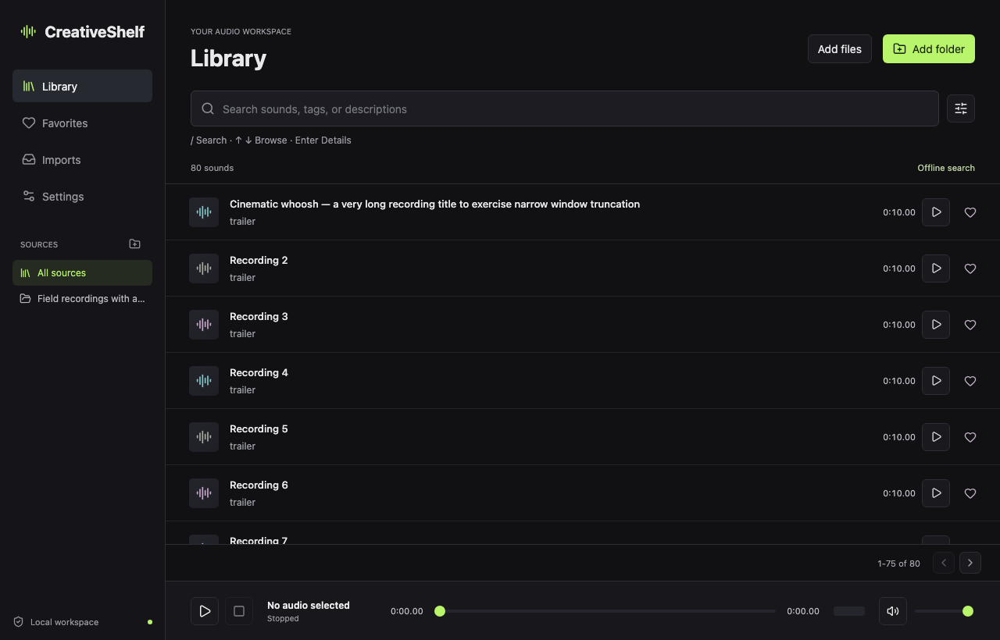

# CreativeShelf

A free, open-source library for your sound effects and audio files. Point it at your folders, then search, preview, tag, favorite and clip sounds, all on your own computer. Image assets and Remotion presets are in development.

## Download

**[Download the latest release](https://github.com/nileshkant/AI-editing-asset-organiser/releases/latest)**, or visit the [CreativeShelf website](https://nileshkant.github.io/AI-editing-asset-organiser/).

| Your computer | File |
|---|---|
| Mac with Apple Silicon (M1 or newer), macOS 14.2+ | `.dmg` |
| Windows 10/11, 64-bit | `-setup.exe` |
| Linux, 64-bit | `.AppImage` or `.deb` (GPG-signed) |

CreativeShelf is distributed directly, not through an app store, so the first launch needs one confirmation:

- **Mac:** open the app once, click **Done** on the warning, then choose **System Settings → Privacy & Security → Open Anyway**.
- **Windows:** if "Windows protected your PC" appears, click **More info → Run anyway**.

The [release notes](docs/RELEASE_NOTES.md) explain each step and how to verify downloads.

## Privacy

- Works offline. No account, no telemetry, no uploads.
- Your audio stays in the folders you choose and is never modified.
- Agent access (MCP) is off by default and only listens on your own computer when enabled.

Report security issues privately as described in [SECURITY.md](SECURITY.md).

## Delivery status

Public beta. Audio is supported; image work continues in the ticket queue. See `tickets/README.md` for the incremental delivery backlog and `docs/reviews/` for test and review evidence. A checked-in feature is not necessarily a release-qualified feature.

## Principles

- One installed desktop app, not a browser tab.
- Local indexing, typo-tolerant search, playback, tags, comments and clipping need no AI key.
- Optional AI is disabled initially. Provider credentials and model capabilities are checked separately.
- Sound IDs and analysis are independent of a folder's current root path.
- Original audio bytes remain untouched. Source-folder metadata catalogs are planned in SS-029. Deleted media is hidden; offline sources retain their metadata.
- UI and MCP use the same services and validation.

## Contribution workflow

Each ticket gets a branch, tests, review notes and a pull request. Dependent branches may be stacked until their parents are merged. Never squash unrelated features into a single PR. Never commit source recordings, local databases, credentials, compiler caches or bundled vendor binaries without the release/license review.

## Development

Development requires Node.js, Rust, platform build tools and FFmpeg. Release packages must bundle qualified media tools so end users do not install these themselves. Platform signing, release builds and bundled media licensing are release gates, not implied by local development success.
